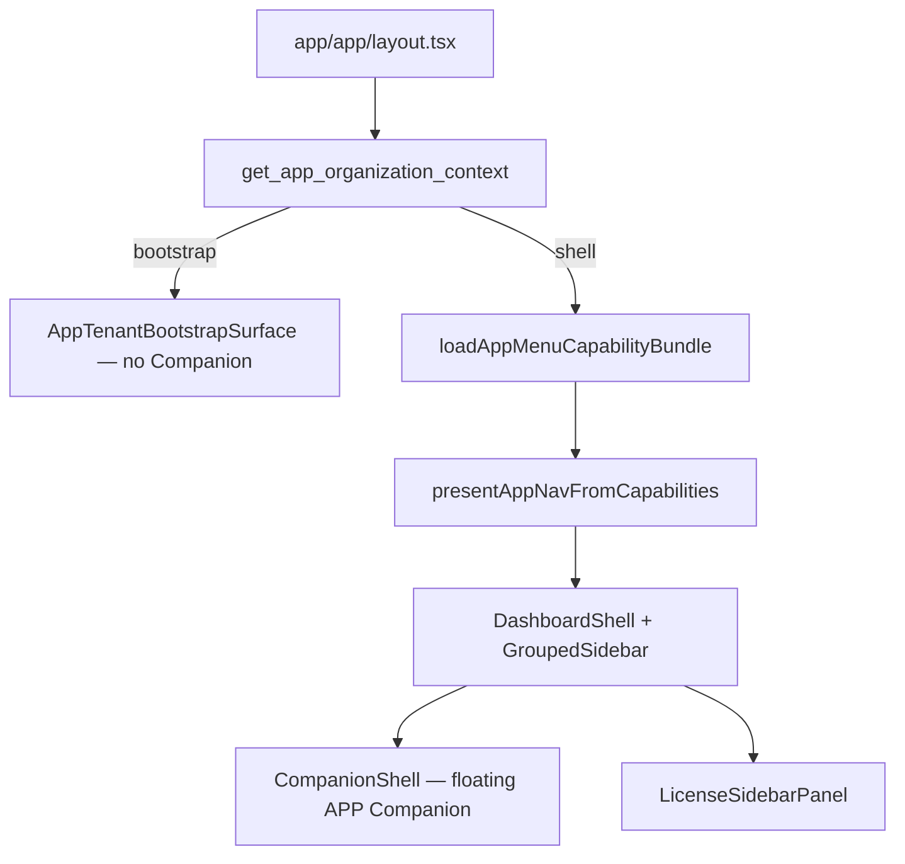
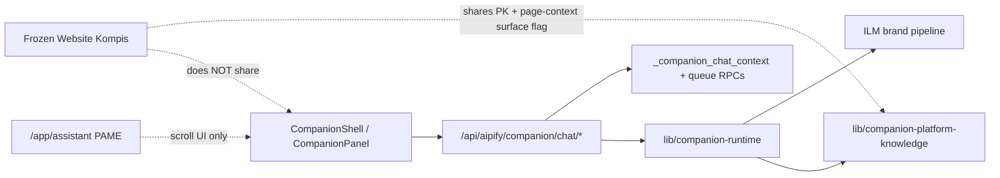
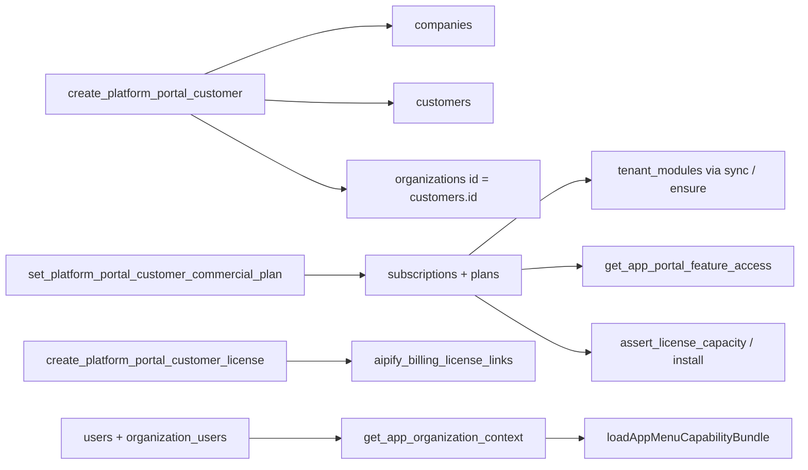

# AIPIFY APP — CURRENT PANEL + LICENSE + IN-APP KOMPIS READ.56 — RESULT

**Job:** `AIPIFY_APP_PANEL_CURRENT_STATE_LICENSE_COMPANION_READ_56`  
**Type:** READ ONLY  
**Repo HEAD:** `c4787a26` (includes freeze PR #147 `5605d0eb` as ancestor)  
**Freeze baseline respected:** Website Kompis Public Chain — `WEBSITE KOMPIS PUBLIC CHAIN FROZEN = YES`  
**Authenticated APP browser:** `BLOCKED` (no SSO bypass; visual runtime not claimed)  
**Evidence classes used below:** `VERIFIED` · `INFERRED` · `UNKNOWN` · `BLOCKED`

---

## Mutation / freeze attestation

| Check | Result |
|-------|--------|
| `RUNTIME/CODE/DB MUTATION` | **0** |
| `FROZEN WEBSITE KOMPIS FILES TOUCHED` | **0** |
| PR / merge / deploy | **none** |
| SQL / secrets / ingest / Production write | **none** |
| Only artifact written | this RESULT file |

---

## 1. Executive verdict — five largest structure problems

1. **Dual nav registries** — Live sidebar is the **44-item** `APP_PORTAL_NAV_GROUPS` (`lib/app-portal/nav-config.ts`), while `lib/app/nav-config.ts` still holds a **mega-nav** (~500+) used for active-path highlight / deep links, and **~1270** `app/app/**/page.tsx` routes exist. Most routes are not in the customer menu. (`VERIFIED`)

2. **Parallel license / commercial models** — At least five coexisting “license” concepts: `subscriptions` + `resolve_license_service_status`, `tenant_modules` + `subscription_packages`, `aipify_billing_license_links`, `organization_app_license_state` / `organization_subscriptions`, plus Trust UI `/app/license` vs management `/app/licenses`. Nav does **not** load `tenant_modules` (`activeModuleKeys: new Set()` always). (`VERIFIED`)

3. **Billing nav is triplicated redirect theatre** — `subscription`, `paymentHistory`, `invoices` all **redirect** to one surface `/app/settings/billing`. True invoices are Platform-owned; APP `billing_history` is subscription rows, not invoice records. (`VERIFIED`)

4. **Three “Kompis/Companion” products are not separated in the APP shell** — Floating **Aipify Companion** (APP drawer), full-page `/app/companion`, sidebar **Kompis** (`/app/kompis` = website CMS operator), and frozen **Website Kompis** public chain share naming in the owner’s product map but not one architecture. Today’s APP Companion is **not** proven suitable as “Aipify APP-Kompis” product without redesign. (`VERIFIED` mounts; product-fit `INFERRED`)

5. **Readiness hides ~⅓ of the registered menu while legacy pages remain reachable** — 15 nav ids are `hidden` (foundation/placeholder); many deep `/app/**` engines remain. Fail-closed nav collapses to ~6 safe items. Customer experience ≠ route inventory. (`VERIFIED`)

**Additional structural note (owner categories):** Faktura + Abonnement should **not** be duplicated under future Kompis Web / Bedrift until a **single account commercial surface** (`/app/settings/billing` + Platform invoice SoT) is affirmed. Current evidence supports **one authoritative account billing function with product cards/links**, not product-local invoice engines. (`VERIFIED` SoT; decision `MÅ AVGJØRES` by owner)

---

## 2. Complete route / menu inventory

### 2.1 Authoritative sidebar source (`VERIFIED`)

| Layer | Path | Role |
|-------|------|------|
| Registry | `lib/app-portal/nav-config.ts` → `APP_PORTAL_NAV_GROUPS` | **44 items · 9 groups** |
| Presentation | `lib/app-portal/canonical-nav/present-from-capabilities.ts` | Intersect registry × capabilities |
| Capability load | `lib/core/app-menu-capability/load-bundle.ts` | RPCs + fail-closed |
| Readiness | `lib/app-production-experience/route-readiness.ts` | hidden / redirect / production |
| Permissions | `lib/app-portal/nav-route-access.ts` | org permission keys |
| Feature fallback | `lib/app-portal/feature-entitlements.ts` | when feature RPC fails |
| Layout | `app/app/layout.tsx` → `DashboardShell` → `GroupedSidebar` | Customer shell |
| Legacy mega-nav | `lib/app/nav-config.ts` → `APP_NAV` | **Not** sidebar source |
| Route aliases | `lib/app/route-aliases.ts` | e.g. security redirects |

**Gate stack (`VERIFIED`):** auth (`CustomerPortalGuard`) → 2FA session → org context branch → role (`organizationRoleAllows`) → `has_organization_permission` → `get_app_portal_feature_access` → business-pack activation gates → route readiness → fail-closed safe set.

**Fail-closed ids:** `appDashboard`, `commandBrief`, `appNotifications`, `gettingStarted`, `knowledgeCenter`, `organizationSettings`.

**i18n:** labels `customerApp.portalStructure.nav.*` · groups `customerApp.portalStructure.navGroups.*` · EN strings in `locales/en/customer-app/portalStructure.json`.

**Desktop width:** sidebar `280px` (`AipifyShellClasses.sidebarDesktopWidth`); content canonical `max-w-[1560px]` when pages adopt `AppLayoutClasses` (`VERIFIED`). Many legacy pages still `max-w-4xl/6xl/7xl` (`VERIFIED`).

**Visual LIVE confirmation:** `BLOCKED` (authenticated APP browser unavailable).

### 2.2 Full sidebar registry (44)

| # | Group | EN label | i18n key | Route (registry) | Resolved href | Readiness | Gates (summary) | Status | Recommendation |
|---|-------|----------|----------|------------------|---------------|-----------|-----------------|--------|----------------|
| 1 | home | Dashboard | `…nav.dashboard` | `/app` | `/app` | production | any; fail-closed | LIVE | **BEHOLD** |
| 2 | home | Command Brief | `…nav.commandBrief` | `/app/command-center/companion-briefing` | same | production | any; fail-closed | LIVE | **BEHOLD** |
| 3 | home | Since Last Login | `…nav.sinceLastLogin` | `/app/since-last-login` | same | production | any | LIVE | **BEHOLD** / later fold into Brief |
| 4 | home | Notifications | `…nav.notifications` | `/app/notifications` | same | production | any; fail-closed | LIVE | **BEHOLD** |
| 5 | organization | Team Members | `…nav.teamMembers` | `/app/organization/team` | same | production | any | LIVE | **BEHOLD** |
| 6 | organization | Roles & Permissions | `…nav.rolesPermissions` | `/app/organization/roles` | same | **hidden** | feature `team_management` | foundation placeholder | **AVVIKLE SENERE** or finish |
| 7 | organization | Responsibilities | `…nav.responsibilities` | `/app/organization/responsibilities` | same | production | any | LIVE | **MÅ AVGJØRES** (Bedrift vs APP) |
| 8 | organization | External Relationships | `…nav.externalRelationships` | `/app/organization/external-relationships` | same | production | any | LIVE | **MÅ AVGJØRES** |
| 9 | organization | Resources | `…nav.organizationalAssets` | `/app/organization/assets` | same | production | any | LIVE | **MÅ AVGJØRES** |
| 10 | organization | Communications | `…nav.communications` | `/app/organization/communications` | same | production | any | LIVE | **MÅ AVGJØRES** (Bedrift) |
| 11 | organization | Activity | `…nav.activityOverview` | `/app/organization/activity` | same | **hidden** | any | foundation | **AVVIKLE SENERE** |
| 12 | businessPacks | Software | `…nav.softwareCatalog` | `/app/software` | same | production | any | LIVE read-only catalog | **BEHOLD** |
| 13 | businessPacks | Installed Packs | `…nav.installedBusinessPacks` | `/app/business-packs/installed` | same | **hidden** | feature `business_packs` | not customer-ready | **SKJUL** (already) / finish |
| 14 | businessPacks | Marketplace | `…nav.marketplace` | `/app/business-packs/available` | same | **hidden** | pack perms | not ready | **SKJUL** / finish |
| 15 | businessPacks | Settings | `…nav.businessPackSettings` | `/app/business-packs/settings` | same | **hidden** | owner_admin + feature | not ready | **SKJUL** / finish |
| 16 | operations | Tasks | `…nav.tasks` | `/app/operations/tasks` | same | **hidden** | any | foundation | **AVVIKLE SENERE** |
| 17 | operations | Workflows | `…nav.workflows` | `/app/operations/workflows` | same | **hidden** | feature `workflows` | foundation | **AVVIKLE SENERE** |
| 18 | operations | Follow-ups | `…nav.followUps` | `/app/operations/follow-ups` | same | production | any | LIVE | **BEHOLD** |
| 19 | operations | Decision Center | `…nav.decisionCenter` | `/app/operations/decision-center` | same | production | any | LIVE | **BEHOLD** |
| 20 | operations | Goals & Plans | `…nav.goalsObjectives` | `/app/operations/goals` | same | production | any | LIVE | **BEHOLD** / Bedrift overlap `MÅ AVGJØRES` |
| 21 | operations | Risk & Compliance | `…nav.risksCompliance` | `/app/operations/risks` | same | production | any | LIVE | **BEHOLD** |
| 22 | operations | Meetings | `…nav.meetings` | `/app/operations/meetings` | same | production | any | LIVE | **MÅ AVGJØRES** (Bedrift) |
| 23 | operations | Operations Center | `…nav.operationsCenter` | `/app/operations` | same | production | any | LIVE | **BEHOLD** |
| 24 | intelligence | Aipify Companion | `…nav.aipifyCompanion` | `/app/companion` | same | production | any | LIVE full-page + floating | **MÅ AVGJØRES** (product split) |
| 25 | intelligence | Kompis | `…nav.kompisOperator` | `/app/kompis` | same | production | any | LIVE website CMS ops | **FLYTT** toward Kompis Web product |
| 26 | intelligence | Intelligence Center | `…nav.intelligenceCommandCenter` | `/app/intelligence/intelligence-command-center` | same | production | ops perms | LIVE | **BEHOLD** / simplify |
| 27 | intelligence | Scenarios & Forecasts | `…nav.scenarioPlanning` | `/app/intelligence/scenario-planning` | same | production | scenario perms | LIVE | **BEHOLD** gated |
| 28 | intelligence | Management Insights | `…nav.managementInsights` | `/app/intelligence/executive-companion` | same | production | any | LIVE | **SLÅ SAMMEN** with Companion later? |
| 29 | billing | Subscription | `…nav.subscription` | `/app/billing/subscription` | **`/app/settings/billing`** | redirect | feature `billing` | LIVE via redirect | **SLÅ SAMMEN** → one Account billing |
| 30 | billing | Payment History | `…nav.paymentHistory` | `/app/billing/payment-history` | **`/app/settings/billing`** | redirect | feature `billing` | duplicate | **SLÅ SAMMEN** |
| 31 | billing | Invoices | `…nav.invoices` | `/app/billing/invoices` | **`/app/settings/billing`** | redirect | feature `billing` | not real invoices | **SLÅ SAMMEN** + clarify Platform SoT |
| 32 | billing | Upgrades | `…nav.upgradeOptions` | `/app/billing/upgrade` | same | **hidden** | feature `billing` | withheld | **SKJUL** |
| 33 | support | Knowledge Center | `…nav.knowledgeCenter` | `/app/support/knowledge` | same | production | fail-closed | LIVE | **BEHOLD** |
| 34 | support | Contact Support | `…nav.contactSupport` | `/app/support/contact` | same | **hidden** | any | foundation | **AVVIKLE SENERE** |
| 35 | support | My Support Cases | `…nav.supportRequests` | `/app/support/requests` | same | production | any | LIVE | **BEHOLD** |
| 36 | support | Getting Started | `…nav.gettingStarted` | `/app/support/getting-started` | same | production | fail-closed | LIVE | **BEHOLD** |
| 37 | support | Aipify Academy | `…nav.customerAcademy` | `/app/support/academy` | same | production | any | LIVE | **BEHOLD** |
| 38 | account | Profile | `…nav.profile` | `/app/account/profile` | same | **hidden** | any | coming-soon | **SKJUL** until real |
| 39 | account | Security | `…nav.security` | `/app/account/security` | same | **hidden** | any | foundation | **FLYTT**/finish → settings security |
| 40 | account | Notification Preferences | `…nav.accountNotifications` | `/app/account/notification-settings` | same | production | any | LIVE | **BEHOLD** (Felles) |
| 41 | account | Organization Settings | `…nav.organizationSettings` | `/app/settings` | same | production | owner_admin; fail-closed | LIVE | **BEHOLD** |
| 42 | integrations | Connected Apps | `…nav.connectedApps` | `/app/platform/integrations/connected` | same | production | feature `integrations` | LIVE | **BEHOLD** (Felles) |
| 43 | integrations | Data Sources | `…nav.dataSources` | `/app/platform/integrations` | same | production | feature `integrations` | LIVE | **BEHOLD** / **SLÅ SAMMEN** with connected |
| 44 | integrations | API & Developer Settings | `…nav.apiDeveloperSettings` | `/app/platform/api-access` | same | **hidden** | feature `integrations` | foundation | **AVVIKLE SENERE** |

**Type orphans (`VERIFIED`):** `AppPortalNavId` lists ~90 ids; only 44 are in groups. Extra ids (e.g. `trustCulture`, `abosCommandCenter`, pack centers) are type/legacy without sidebar rows.

**Filesystem routes (`VERIFIED`):** **1270** `app/app/**/page.tsx` — regenerate with `find app/app -name page.tsx`. Catch-all: `app/app/[...slug]/page.tsx`.

---

## 3. Side-by-side decision matrix (owner product lenses)

| Concern | Today in APP | Kompis Web (target lens) | Kompis Bedrift (target lens) | Aipify APP-Kompis (target lens) | Recommendation |
|---------|--------------|--------------------------|------------------------------|--------------------------------|----------------|
| Public visitor FAQ / site | Frozen Website Kompis (Core) — **out of APP panel** | Primary | No | No | Keep frozen; do not reuse APP Companion |
| Website CMS / FAQ ops | `/app/kompis` Kompis Operator | Primary ops | No | Help-about-product only | **FLYTT** under Web product IA |
| Floating help in APP | CompanionShell on `/app/*` | No | Optional later | **Intended home** | Redesign as Platform-provisioned APP-Kompis — **not** assume current fit |
| Employees / private docs | Partial org + ops surfaces; no dedicated Bedrift product shell | No | Primary | Context only | **MÅ AVGJØRES** — do not rename existing pages into Bedrift without SoT |
| Subscription / Faktura | One billing center + 3 fake nav entries | Account link | Account link | Explain plan/license | **SLÅ SAMMEN** to one Account commercial function |
| Integrations / Notifications | Account + Integrations groups | Shared | Shared | Advise | **BEHOLD** as Felles |

---

## 4. APP-Kompis / Companion — dependency map & controlled retirement path

### 4.1 What exists today (`VERIFIED`)

| Surface | Mount | Identity |
|---------|-------|----------|
| Floating drawer + button + top-bar | `DashboardShell` → `CompanionShell` when `shellVariant==="customer"` && pathname `/app*` && labels | Authenticated org user via session + `_companion_chat_context()` |
| Full-page | `/app/companion` → `CompanionPanel` mode `fullpage` | Same queue/API |
| Hidden floater | pathname === `/app/companion` | Top bar button still visible |
| Absent | Tenant bootstrap layout; Platform layout | — |
| Sidebar “Kompis” | `/app/kompis` | **Different product** — website CMS operator (`lib/kompis-operator/`) |
| Website Kompis | Host embed + `/api/marketing/companion/ask` | **Frozen** — separate |

### 4.2 Dependency map

| Concern | Finding | Class |
|---------|---------|-------|
| Knowledge | Platform corpus + support-assistant + APP page-context; **not** Website FAQ/site-index | `VERIFIED` |
| Persistence | `companion_conversations`, `companion_chat_messages`, `companion_message_queue` | `VERIFIED` |
| License gate on turns | Worker `_companion_worker_assert_scope` → paused → `app_suspended` | `VERIFIED` |
| Plan flag hiding launcher | **Not found** in shell | `UNKNOWN` / absent |
| SPA visibility quirks | `sessionStorage` panelOpen; `panelEverOpened` keep-mounted; bootstrap vs shell | `VERIFIED` |

### 4.3 What would be orphaned if floating shell removed without replacement

High coupling: `components/app/companion-experience/*`, `lib/app/companion/**`, `app/api/aipify/companion/**`, queue cron worker, companion chat migrations/RPCs, desktop chat panels, any panel opening drawer via `useOptionalCompanionExperience`.

Survives: frozen Website Kompis, Kompis Operator, PAME `/app/assistant`, most non-drawer `/app/companion/*` dashboard modules (unless they assume global drawer).

### 4.4 Controlled retirement path — **documentation only, do not execute**

| Step | Action | Risk |
|------|--------|------|
| R0 | Inventory callers of `useOptionalCompanionExperience` / `CompanionShell` | Low |
| R1 | Feature-flag **hide floating launcher only**; keep `/app/companion` + APIs | Medium UX |
| R2 | Freeze schema writes for new conversations if replacing product | Medium |
| R3 | Migrate or archive queue/messages; keep Platform knowledge for new APP-Kompis | High |
| R4 | Remove shell mount after replacement provisioned at customer create | High |
| R5 | Decouple shared `companion-runtime` carefully — marketing ask still uses pieces | **High** — do not break frozen public chain |

**Do not** hide or remove anything in this job.

---

## 5. Customer / license / entitlement chain

### 5.1 Authoritative flow (`VERIFIED` unless noted)

| Link | Authoritative store / RPC | Writer | Reader | Notes |
|------|---------------------------|--------|--------|-------|
| Customer create | `create_platform_portal_customer` | Platform API | Platform list/detail | **No** subscription/license at create (`VERIFIED`) |
| Org / workspace | `organizations` synced `_mta_sync_organization_from_customer` | create sync | APP context | org PK = customer UUID |
| Owner/admin | `users.role` + `organization_users` + permissions | Platform/APP invites | `_apsf260_require_app_access`, context | subscription must be active/trialing/past_due |
| Plan | `subscriptions` + `plans` | `set_platform_portal_customer_commercial_plan` | billing/license/feature RPCs | Parallel: `organization_subscriptions` (SPM) |
| Modules | `tenant_modules` + `subscription_packages` | `sync_tenant_modules_from_package`, ensure | `is_tenant_module_enabled` | **Not** wired into nav loader today |
| License codes | `aipify_billing_license_links` | Platform license provision | License center (masked) | types: app_subscription, domain, pack, … |
| APP license status | `organization_app_license_state` | `_ls510_sync_from_subscription` | context `license_status` | prefers SPM then subscriptions |
| Install capacity | `assert_license_capacity` + `resolve_license_service_status` | install/domain RPCs | Install Engine | 3-day grace on past_due |
| Menu visibility | capability bundle + readiness | N/A | layout | **not** `tenant_modules` |

### 5.2 Upgrade / downgrade / suspend / cancel (`VERIFIED` + `INFERRED`)

| Event | Mechanism |
|-------|-----------|
| Suspend / pause services | `license_service_status` via `resolve_license_service_status` (active → grace → paused); `assert_license_capacity` blocks ops when paused |
| Cancel / paused subscription | status → paused service |
| Plan change (Platform) | `set_platform_portal_customer_commercial_plan` updates `subscriptions` |
| Module sync after plan set | **Not** in commercial-plan migration — may lag until ensure/sync (`INFERRED` gap) |
| Partner sale | Platform remains writer of customer/plan/license; Partner attribution only — do **not** bypass Platform (`VERIFIED` architecture rules; Partner product assignment path `INFERRED` via Platform delivery RPCs e.g. `deliver_platform_customer_app_and_website_kompis`) |

### 5.3 Open breaks (`VERIFIED` / `INFERRED`)

1. Multiple license SoTs without single reconciliation writer.  
2. Nav ignores `tenant_modules` (`activeModuleKeys` empty).  
3. Possible `company_id` vs `customers.id` mismatch in older sync paths (`INFERRED` from phase295 snippet).  
4. Two APP license UIs: `/app/license` (Trust) vs `/app/licenses` (subscription center).  
5. Creation does not auto-provision APP-Kompis product identity as owner’s target model — delivery RPCs exist for App+Website Kompis (`VERIFIED` name) but product separation incomplete (`INFERRED`).

**Do not propose new schema until owner picks authoritative SoT.** Prefer documenting: **Platform commercial plan + `subscriptions` for service status; `tenant_modules` for product modules; Platform invoice records for Faktura; APP billing center as read presentation.**

---

## 6. Faktura / abonnement / integrasjoner / varsler

| Domain | Customer APP route(s) | API / RPC | Source of truth | Issues |
|--------|----------------------|-----------|-----------------|--------|
| Subscription / plan | `/app/settings/billing` (+ 3 redirected billing nav items) | `GET /api/commercial-packages/billing` → `get_customer_billing_center` | `subscriptions`, packages, `tenant_modules`, usage metrics, license limits | Nav labels imply separate pages |
| Invoices | redirected to billing; readiness says Platform owns invoices | Billing center `billing_history` = **subscription rows** | Legacy `invoices` vs Phase 586 `aipify_billing_invoice_records` | **No true APP invoice SoT**; duplicate nav |
| Payment method / status | Billing center view model | same | subscription status + license_service_status | `INFERRED` depth |
| Trust / license copy | `/app/license`, sidebar panel | `get_customer_license_center` | subscriptions + masked license links | Parallel to `/app/licenses` |
| Integrations | `/app/platform/integrations`, `/connected` | `app/api/app-portal/integrations/*` | vault + connection tables (Core secret stream) | Path under `platform` inside APP is naming debt |
| Notifications inbox | `/app/notifications` | presence/notifications APIs | notification engine tables | LIVE |
| Notification prefs | `/app/account/notification-settings` | `/api/notifications/preferences` | communication preferences RPCs | LIVE — Felles |

**Verdict on Faktura vs Abonnement:** Treat as **one Account commercial hub** with sections/cards (plan, payment status, invoice list when Platform exposes read RPC). Do **not** build separate Web/Bedrift invoice implementations. (`VERIFIED` redirects + docs; owner decision still `MÅ AVGJØRES` for IA labels only)

---

## 7. Design system & language map

### 7.1 Design (`VERIFIED`)

| Token | Value / pattern | Path |
|-------|-----------------|------|
| Canvas | `#F7F6F3` | `AipifyDesignColors` / `globals.css` |
| Companion Purple | `#7C3AED` | same |
| Accent | `#6366F1` | same |
| Text primary | `#1E293B` (slate/navy) | same |
| Max content width | **1560px** | `lib/design/app-layout.ts` |
| Sidebar | 280px desktop; mobile bottom nav `lg` | `DashboardShell` |
| Cards | `rounded-2xl`, `shadow-sm` | `AppLayoutClasses` |
| Buttons | class bundles, not shadcn Button | `AipifyShellClasses` |
| Tabs / segmented | `AppSectionTabs` | `components/app/design/` |
| Icons | `lucide-react` (~16–20px; nav 18px) | various |
| Status | `status-system` + `semantic-status-system` | `lib/design/` |
| Breakpoints | Tailwind defaults; shell split at `lg` | `INFERRED` |

**vs owner direction:** Width 1560 and purple/navy **align**. Body often **13–14px** (owner wants 14–16). Icons not uniformly large/colored. Many legacy narrow pages. Dropdowns still common; segmented tabs exist but not global.

### 7.2 Languages (`VERIFIED`)

| Set | Locales |
|-----|---------|
| CORE | `en`, `no`, `sv`, `da`, `pl`, `uk` |
| EXTENDED | `es` |
| Customer APP picker | no, sv, da, en, es, pl, uk |
| `locales/*/customer-app/` splits | 14 splits × 7 locales |
| Monolith `customerApp.json` | 7 locales |

| Requested | Status |
|-----------|--------|
| German `de` | **Absent** from `LOCALES` and `locales/de`; footer order mentions de as disabled until registry+translations |
| Finnish `fi` | **Absent** |

**Fallback:** English deep-merge via `getDictionary` / customer-app split loaders (`VERIFIED`). Missing keys → English leakage risk in non-en (`INFERRED` for completeness audits).

**To add de/fi later (not this job):** add to `CORE_LOCALES` or `EXTENDED_LOCALES`, create `locales/{de,fi}/**` including all customer-app splits + root namespaces, update picker registries, run `validate:app-i18n`.

---

## 8. FORSLAG — IKKE GODKJENT — målarkitektur navigasjon

> Merket eksplisitt **FORSLAG — IKKE GODKJENT**. Ingen implementering.

### 8.1 Product shells (three products)

1. **Kompis Web** — public site + FAQ sources + Kompis Operator (today `/app/kompis`) + domain/install connection.  
2. **Kompis Bedrift** — invited employees, private documents/FAQ, meetings/comms (subset of today’s org/ops).  
3. **Aipify APP shell** — account, team, billing, integrations, notifications, software catalog + **Aipify APP-Kompis** (Platform-owned help).

### 8.2 Proposed top-level IA (Account-centric commercial)

| Group | Items |
|-------|-------|
| Home | Dashboard · Command Brief · Notifications |
| Products | Kompis Web · Kompis Bedrift · Software / Packs |
| Work | Tasks/Ops subset that remains APP-owned |
| Account | Organization · Team · **Plan & billing** (single) · Security · Notification prefs |
| Connect | Integrations · Install/license status |
| Help | Knowledge · Support cases · Academy · APP-Kompis |

Collapse today’s three billing nav entries into **Plan & billing**. Keep invoice detail as section or deep link when Platform read API exists.

### 8.3 APP-Kompis provisioning (proposal only)

At `create_platform_portal_customer` + commercial plan: provision APP-Kompis capability (entitlement + empty conversation scope) with **only** Aipify product/plan/license context — not Website visitor FAQ, not Bedrift private docs.

---

## 9. Gjenbruksoversikt — keep candidates

| Asset | Reuse |
|-------|-------|
| `APP_PORTAL_NAV_GROUPS` + capability + readiness pipeline | Keep as nav engine; shrink items |
| `AppLayoutClasses` 1560 + Light Enterprise tokens | Keep as design baseline |
| `/app/settings/billing` + billing view model | Keep as commercial hub |
| Integration secret stream (save/test/activate) | Keep Core contract |
| Notification prefs + inbox | Keep as Felles |
| Command Brief / Command Center patterns | Keep Home |
| `CompanionPanel` UX primitives | Possible reuse inside new APP-Kompis **after** policy rewrite |
| `lib/companion-platform-knowledge` | Reuse for APP-Kompis product help |
| Kompis Operator | Reuse under Kompis Web |
| Frozen Website Kompis | Untouched public product |
| i18n split architecture + 6 core locales (+ es) | Keep; extend for de/fi later |
| `AppSectionTabs`, status badges, empty/loading patterns | Keep |

---

## 10. Risk register — removal & rebuild

| ID | Risk | Severity | Mitigation |
|----|------|----------|------------|
| R1 | Touch frozen Website Kompis while rebuilding APP Companion | Critical | Freeze contract + manifest; separate PRs |
| R2 | Remove floating Companion → orphan queue/cron/desktop | High | Flag hide → migrate → delete |
| R3 | Pick wrong license SoT → broken install/billing | High | Owner picks SoT before schema |
| R4 | Nav shrink hides live deep links customers bookmark | Medium | Redirects + readiness |
| R5 | Dual `/app/license` vs `/app/licenses` confuses rebuild | Medium | Single Trust & License entry |
| R6 | English fallback mistaken for localization complete | Medium | validate:app-i18n before lock |
| R7 | Partner assigns product without Platform write | High | Platform-only commercial writers |
| R8 | Bedrift rename without private-doc SoT | High | Map storage first |
| R9 | Authenticated visual unknown (`BLOCKED`) | Medium | Owner LIVE pass before IA lock |
| R10 | Shared `companion-runtime` change breaks marketing ask | High | Contract tests; don’t edit frozen chain |

---

## 11. Recommended first implementation job (scope only — **do not execute**)

### Job title (proposed)

**`AIPIFY_APP_ACCOUNT_BILLING_NAV_CONSOLIDATION_READWRITE_57`** (name illustrative)

### Exact scope

1. **IA only on billing group:** replace three redirect nav items (`subscription`, `paymentHistory`, `invoices`) with **one** nav item → `/app/settings/billing` (label e.g. Plan & billing / Abonnement og faktura).  
2. Update `APP_PORTAL_NAV_GROUPS`, readiness (remove redundant redirects), EN+core locale nav keys.  
3. On billing page: clear sections for plan status, payment/service status, and an **honest** invoices section (Platform-owned; empty/locked state if no read RPC — no fake `billing_history` as invoices).  
4. **Out of scope:** Companion removal, Website Kompis, Bedrift product shell, schema changes, invoice mutation, Partner, de/fi locales, mega-nav deletion.

### Acceptance

- Single billing nav entry visible when `billing` feature allows.  
- No third duplicate billing hrefs in sidebar.  
- Copy does not claim APP owns Platform invoices.  
- `FROZEN WEBSITE KOMPIS FILES TOUCHED = 0`.  
- Core locales updated for touched keys.

### Why first

Lowest risk, unblocks owner’s Web/Bedrift “Faktura vs Abonnement” question with **evidence-aligned** Account hub, without product rebuild.

---

## Evidence limits

| Item | Status |
|------|--------|
| Repo + migrations + nav/capability code | `VERIFIED` |
| Live authenticated APP UI / tenant-specific visible menu | `BLOCKED` |
| Remote DB apply order / live row reconciliation | `UNKNOWN` |
| Customer names | omitted (Core no-customer-names) |

---

## Stop

READ.56 complete. Report only. No PR, merge, deploy, or runtime change.

**RUNTIME/CODE/DB MUTATION = 0**  
**FROZEN WEBSITE KOMPIS FILES TOUCHED = 0**
