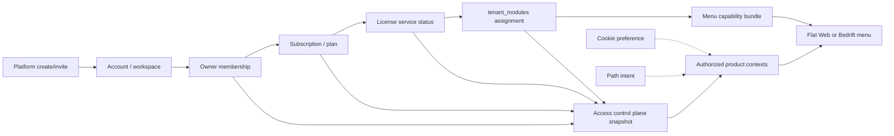

# AIPIFY – PLATFORM → APP PROVISIONING & LICENSE CONTROL PLANE BUILD 62 — RESULT

**Branch:** `feature/platform-app-provisioning-license-control-plane-62`  
**Feature commit:** `7633efa0fac431868006eb6946947964b1b0e463`  
**PR:** [#154](https://github.com/aipify-project/aipify-platform/pull/154)  
**Merge SHA:** _(filled after merge)_  
**APP project:** `aipify-platform` (`prj_tPgcqwgUAAkGvBy802arVXVYf1fv`)  
**Deployment ID:** _(filled after deploy)_  
**Canonical domain:** `app.aipify.ai`

| Gate | Result |
|------|--------|
| `READY FOR OWNER PLATFORM + APP TEST` | **YES** (after LIVE) |
| `SAFE TO FREEZE CONTROL PLANE` | **NO** |
| `MIGRATION CREATED/APPLIED` | **NO** |

---

## Truth-source matrix (existing — not merged by name)

| Source | Table / RPC / API | Owner | Writers | Readers | Status values | Tenant key | Product key | Conflict / fallback | Active / legacy |
|--------|-------------------|-------|---------|---------|---------------|------------|-------------|---------------------|-----------------|
| Org membership | `get_app_organization_context` | Core | Platform invite / membership | APP layout, control plane | ready / selection / missing | org / customer id | — | fail closed without membership | Active |
| Subscription | `subscriptions` via license center / commercial detail | Core / Platform | Platform commercial plan | Billing, control plane | active / trialing / past_due / cancelled / expired | customer_id | plan key | cancelled/expired block products | Active |
| License service | `resolve_license_service_status` / `get_customer_license_center` | Core | payment resolution | Trust UI, control plane | active / grace_period / paused | customer_id | — | paused blocks products | Active |
| Module assignment | `tenant_modules` + `is_tenant_module_enabled` | Core | package sync, Platform WK activate | Menu capability, control plane | enabled/disabled/trial/beta… | tenant_id | `module_key` | **Web requires explicit enable (fail closed)** | Active |
| Business packs | pack activation gates | Core | pack license actions | Menu capability | active / pending / suspended… | org | pack_key | pending/revoked hide pack nav | Active |
| Product cookie | `aipify_app_product_context` | APP | browser | layout (preference only) | kompisWeb / kompisBedrift | — | product id | never authorizes alone | Active |
| Path context | pathname infer | APP | — | control plane authz | Web/Bedrift routes | — | product id | unauthorized path → safe fallback | Active |
| Platform licenses | customer detail licenses[] | Platform/Core | license provisioning RPCs | Platform detail + control summary | active / suspended / … | customer_id | product_code | length alone ≠ ready | Active |
| Domain/install | domains + installations | Platform/Core | domain-installation RPCs | Platform detail, WK delivery | verified / … | customer_id | website_kompis | required for provisioningReady | Active |
| Org feature flags | `organization_feature_flags` | APP | toggle API | deployments UI | on/off | org | flag key | **not** menu entitlement | Separate |
| Reserved Design Studio | typed catalog only | Core contract | none (job 62) | control plane modules | hidden_reserved | — | `kompis_design_studio` | never navigable | Reserved |

### Dependency diagram

---

## Canonical server contract

**Module:** `lib/core/access-control-plane/`

| Export | Role |
|--------|------|
| `loadAccessControlPlaneSnapshot` | Session RPC loader (org + license center + WK module) |
| `resolveAccessControlPlaneSnapshot` | Pure snapshot / product / module views |
| `authorizeProductContext` | Cookie = preference; path = intent; server = authority |
| `evaluateActivationGate` | Atomic AND of payment/contract · subscription · license · module · tenant/product · runtime |
| `buildPlatformCustomerControlPlaneSummary` | Read-only Platform overview over existing detail payload |
| `KOMPIS_DESIGN_STUDIO_CAPABILITY_KEY` | Reserved paid add-on — hidden |

**Reason codes (safe):** `ok`, `membership_missing`, `product_not_entitled`, `module_status_unknown`, `license_paused`, `subscription_invalid`, `path_not_authorized`, `cookie_not_authorization`, `reserved_capability_hidden`, `activation_gate_incomplete`, …

**Client rules:** no client-supplied tenant/product authorization; fail closed on denied/unknown Web module; suspended/cancelled products not active.

---

## Product context rules (wired in `app/app/layout.tsx`)

1. Load control-plane snapshot + capability bundle in parallel.  
2. Authorize products from snapshot.  
3. Intersect with capability-visible products.  
4. Cookie never expands allowlist.  
5. Unauthorized path falls back to first authorized product (`path_not_authorized`).  

---

## Provisioning / write paths (existing — not duplicated)

| Step | Existing path | Job 62 |
|------|---------------|--------|
| Create customer | `create_platform_portal_customer` | Documented / consumed via detail |
| Commercial plan | commercial-plan APIs | Read in summary |
| License issue | license-provisioning | Read in summary |
| Domain+install | domain-installation | Counts → provisioningReady |
| Activate WK | website-kompis activation | Feeds `tenant_modules` |
| Deliver APP+WK | app-kompis-delivery | Unchanged |

**No new write orchestration** without migration. Partial failure / retry remains on existing idempotent Platform RPCs.

**State machine (read model):** pending → active when membership + license active + domain/install present; suspended/expired/cancelled from license/subscription; conflict when Web module unknown.

---

## Activation gate

`Payment/contract valid` ∧ `subscription valid` ∧ `license valid` ∧ `module assignment valid` ∧ `tenant/product valid` ∧ `runtime capability ready` → visible + usable.

Missing any mandatory check → not visible/usable; configuration retained; admin reason code exposed on Platform summary.

---

## `tenant_modules` status

- **Priority for Kompis Web:** authoritative enable/deny via `is_tenant_module_enabled`.  
- **Job 62 change:** unknown/error → Web nav **hidden** (was fail-open).  
- **Bedrift:** no dedicated module row yet — membership + license/subscription gates; catalog key `kompis_bedrift` reserved for future assignment.  
- Not used blindly: denied sentinel, explicit enable, unknown ≠ enabled.

---

## Reserved `kompis_design_studio`

- Catalog entry: paid add-on for Web + Bedrift  
- Lifecycle: `hidden_reserved`  
- Menu: not visible  
- No templates, CSS, editor, or purchase UI  

---

## Platform control surface

Read-only **Access control overview** card on Platform customer detail (`PlatformPortalCustomerDetailPanel`) summarizing overall status, membership, provisioning readiness, modules count, and product badges — drill-down remains existing sections. No force-active, no destructive reset, no invoice generation.

---

## Implemented vs blocked

| Implemented | Blocked (needs migration / separate approval) |
|-------------|-----------------------------------------------|
| Typed control-plane read model | New product/module tables or Core `active_product` |
| Fail-closed Web module gate | Dedicated Bedrift `tenant_modules` writer |
| Product authz in APP layout | Full Platform write orchestration / compensation UI |
| Platform read-only overview card | Automatic email on provision |
| Reserved Design Studio capability id | Design Studio product build |
| Contract tests | Authenticated browser QA |

**Proposed migration (NOT created):** optional `tenant_modules` row / entitlement for `kompis_bedrift` + optional durable product context column — only if owner later requires Bedrift fail-closed parity with Web. SQL deferred.

---

## Locale

`platform.customers.detail.controlPlane.*` added for `en`, `no`, `sv`, `da`, `pl`, `uk`.  
`es` platform split lacks `customers.detail` tree — English fallback via dictionary merge (documented gap).

---

## Tests / build

| Check | Result |
|-------|--------|
| `access-control-plane-62.test.ts` | PASS |
| app-menu-capability + bypass scenarios | PASS |
| flat-account-nav-60 | PASS |
| `tsc --noEmit` | PASS |
| `npm run build` | PASS (EXIT 0, ~930s) |
| Frozen WK hashes | **0** |
| SQL/migration diff | **0** |
| Authenticated UI-QA | **BLOCKED** |

---

## Preservation flags

| Flag | Value |
|------|-------|
| auth preserved | YES |
| `/app/kompis` preserved | YES |
| old APP Companion absent | YES |
| Frozen Website Kompis files/hashes/runtime diff | **0** |
| MIGRATION CREATED/APPLIED | **NO** |
