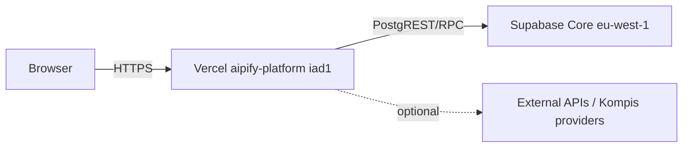

# Capacity & Hosting Assessment (2026-11-27)

**Status:** `REPORT_ONLY` — no upgrades, SQL, secrets, plan, or region changes  
**Repo:** `aipify-project/aipify-platform`  
**Builds on:** [SALES_PARTNER_STABILITY_PERFORMANCE_INVESTIGATION_20261127.md](./SALES_PARTNER_STABILITY_PERFORMANCE_INVESTIGATION_20261127.md) (#413)  
**Window:** UTC `2026-11-20T00:00:00Z` → `2026-11-27T01:00:00Z` (7d + first post-#413 hour)  
**Production HEAD at report time:** `2f257ffa8` (#414) · #413 LIVE at `d87272f67` / `dpl_6XCcuvNvyJxGLiKvhfUiqDe6Cpgz` (READY `2026-11-26T23:50:36Z`)

---

## A. Verdict (data-backed)

**Anbefaling: optimaliser først — ikke oppgrader compute/hosting nå.**

The dominant load on Production during the slow seller/partner window was **client-driven polling of three Platform sellers APIs**, not database CPU saturation or Vercel function memory exhaustion. #413 already removed the layout-wide 3-RPC storm; measured path volume on 2026-11-26 matches that diagnosis. A larger Supabase instance or Vercel plan would **not** have fixed the remounting timers or pathname unread fetches.

Residual risk after #413 is **intentional** 3-RPC polling while operators stay on `/platform/sellers/*`, plus cross-region RTT (Vercel `iad1` → Core `eu-west-1`). Those are optimisation / placement questions, not evidence of hard capacity failure today.

---

## B. Actual architecture (not one server)

| Layer | Resource | Confirmed identity | Region / plan signals |
|---|---|---|---|
| App runtime (SSR, Route Handlers, cron) | Vercel project `aipify-platform` `prj_tPgcqwgUAAkGvBy802arVXVYf1fv` | Domain `app.aipify.ai` · team `unonight-platform-s-projects` | Function region on #413 deploy: **`iad1`** · Node `24.x` · billing shows **Pro** subscription line |
| Database / Auth / Realtime / Storage | Supabase **Aipify Core** `qbcqoixhrvhnuwphefvw` | `ACTIVE_HEALTHY` · Postgres **17.6** | **`eu-west-1`** · Org **Pro** (`tier_pro`) · `max_connections=90` ⇒ compute size **Small** (official table: Small = 90 direct connections) |
| Staging Core (separate) | `auedugihkduoaikfusqe` | Not Production | eu-west-1 |
| Preview → Core | Vercel env | Documented in #413 F7 | Preview shares Production `NEXT_PUBLIC_SUPABASE_URL` — **not** an isolated test DB |
| Kompis / external model APIs | App + Gateway paths | Existing product surface | **No new paid probe calls** in this job — provider latency **NOT_MEASURED** here |
| Desktop / other Vercel projects | Out of seller-panel scope | — | Not attributed to seller lag without path evidence |

Secrets and connection strings are not recorded in this report.

---

## C. Metrics table

| Metric | Value / window | Source | Limit / context | Assessment |
|---|---|---|---|---|
| Vercel requests (sum) | **60 991** · 2026-11-20→27 | Observability `vercel.request.count` | Fair-use / Pro PAYG | Spike day = 26 Nov |
| Requests by day | 20→26 Nov: 1979, 2382, 2939, 2001, 1857, **8203**, **41630** | same | — | 26 Nov ≈ **20×** quiet day |
| Function invocations (sum) | **51 715** · 7d | `vercel.function_invocation.count` | Pro: \$0.60 / 1M after credit ([pricing](https://vercel.com/pricing) 2026-11-27) | Volume driven by API polls |
| Function duration p50 | ~9–21 ms most days; **747 ms** on 26 Nov | `function_duration_ms` p50 | Duration ≠ CPU shortage | Median healthy except storm day |
| Function duration p95 | Quiet days ~60–280 ms; **26 Nov day p95 ~4.95 s**; hourly peaks **15–24 s** | same p95 | High p95 with low throttle → cold/slow routes or queueing under poll flood | Investigate paths, not auto-upgrade RAM |
| Peak function memory | **390 MB** max (26 Nov) | `peak_memory_mb` max | Typical default provision ≫ 390 MB | **Not** memory-bound |
| CPU throttle avg | ~12–19% most days; **7.4%** on 26 Nov | `cpu_throttle_percent` avg | Higher request day, **lower** throttle % | Contradicts “CPU starved host” story |
| Top paths 26 Nov | sellers **partners 6396** · **messages 6383** · **settlements 6342** (~46% of day) | groupBy `request_path` | Matches pre-#413 layout poll | **Client storm / over-poll** |
| Next paths 26 Nov | companion-queue-worker 1441 · org-context 1337 · presence 1180 · CSP messages 918 | same | Background + partner | Secondary |
| Hourly requests 26 Nov | Evening **21–23 UTC: 6507 / 9148 / 9011** | hourly sum | #413 READY ~23:50 UTC | Spike **before** fix fully live |
| Post-#413 27 Nov 00–01 UTC | **2439** requests; sellers trio still **654 each** | path groupBy | Expected while `/platform/sellers/*` open (products page present) | Scoped poll still costly if many tabs |
| Core DB size | **364 MB** | `pg_database_size` | Pro includes 8 GB disk | Far below disk ceiling |
| Core connections | **16** now / **90** max | `pg_stat_activity` / `max_connections` | Small = 90 direct | **~18%** of direct cap — not exhausted |
| Core active queries | 1 active at sample | `pg_stat_activity` | — | Idle capacity at sample |
| CSP RPCs (statement stats) | `csp_get_platform_overview` ~605 calls · mean **1.4 ms**; settlements ~597 · **0.5 ms** | `pg_stat_statements` | Means are low | DB time not the seller lag driver |
| Auth connections advisor | Auth capped at **10** connections (absolute) | Performance advisor INFO | Scaling instance alone won’t raise Auth pool unless strategy changed | Note only — no Auth failure tied to seller panel |
| Performance advisors | 2777 unindexed FKs (INFO); 11 RLS initplan WARN; 1 duplicate index WARN | `get_advisors` performance | Hygiene debt | **Not** proven cause of 26 Nov spike |
| Health advisors | empty | `get_advisors` health | — | No health red flags |
| Vercel runtime errors (sample) | Client/server label boundary on partners pages; refresh-token noise | `get_runtime_errors` | Low counts | Correctness, not capacity |
| Vercel billing sample | **\$91.96** effective · window ~2026-11-25 08:00→26 08:00 UTC · **\$90.41 Build CPU Minutes** · Functions ~**\$0.50** | `list_billing_charges` 1-day | Pro line present | **Build**, not runtime, dominates that day |
| Supabase org plan | **Pro** | MCP `get_organization` | Official Pro from \$25/mo + compute ([pricing](https://supabase.com/pricing) 2026-11-27) | Org confirmed Pro |
| Core compute size | Inferred **Small** (2 GB, 90 conns) | `max_connections=90` vs official table | Micro=60, Small=90, Medium=120 | Dashboard SKU name **NOT_READ** in MCP project payload |
| Core CPU % / IO wait / disk growth rate | **NOT_AVAILABLE** | No Metrics API in this tool set | — | Absence ≠ green |
| Pooler saturation | **NOT_AVAILABLE** | — | Small pooler limit 400 (docs) | — |
| Kompis provider latency / rate limits | **NOT_AVAILABLE** | No paid probe | — | Do not blame Kompis without traces |
| Concurrent customer capacity estimate | **NOT_CLAIMED** | Need controlled load model | — | Forbidden to invent from page count / DB size |
| Innlogget browser p95 | **NOT_RUN** | Same gap as #413 | Owner test plan still valid | |

---

## D. What #413 changed in load (measurable)

| Evidence | Before (#413) | After (partial) |
|---|---|---|
| Code contract (stability doc §E) | Idle platform off-sellers: **3 RPC / 20s** | **1 RPC (messages) / 60s** |
| Production path volume 26 Nov | partners+messages+settlements ≈ **19.1k** (~46% of all requests) | Fix LIVE only last ~10 minutes of day |
| 27 Nov 00–01 UTC | — | Trio still equal **654** while sellers products open — consistent with **on-sellers** full poll, not layout-wide storm proof |
| Partner soft-nav unread | Extra fetch every pathname | Removed off communication routes (code) |

**Do not** use the 26 Nov storm alone to justify a paid upgrade. Use it as proof that **request multiplication** was the bottleneck class.

---

## E. Bottleneck classification

| Class | Finding | Confidence |
|---|---|---|
| Client unnecessary requests / leaked timers | **Confirmed** — #413 F1–F3; path counts prove sellers trio dominated | High |
| Inefficient calls / missing cache | Layout gate per soft-nav (F8); list-100 for badges (optional unread RPC) | Medium (known, not capacity) |
| True resource saturation / quota | Connections 16/90; peak mem 390 MB; throttle fell on spike day; DB means ms | **Not supported** for upgrade |
| External API limits | Kompis provider RTT **NOT_AVAILABLE** | Unknown |
| Region / network | Runtime **iad1**, Core **eu-west-1** — extra RTT on every RPC | Medium as latency tax; not proven as 15 s p95 sole cause |
| Missing measurements | Core CPU%, IOPS, pooler, post-#413 multi-day path share, browser p95 | Explicit gaps |

**A larger database does not fix a polling storm.** Optimisation (#413) and capacity can both matter later; today the evidence says **optimisation first**.

---

## F. Recommendation & verified cost

### Comparison

| Option | What it does | Expected effect | Risk | Rollback |
|---|---|---|---|---|
| **A. Keep current setup** | No plan/compute change | Stable if #413 holds and sellers tabs limited | Residual latency iad1↔eu-west-1 | N/A |
| **B. Optimise first (recommended)** | Keep #413; owner browser verify; optional unread-count RPC; consider sellers poll only when alerts menu needs partners/settlements; measure 7d path share | Cuts avoidable invocations & cost | Low (code-only, separate approval) | Revert PR |
| **C. Smallest relevant upgrade (only if B fails with saturation proof)** | Core Small → **Medium** | More RAM/CPU/headroom (120 conns) | Downtime on resize; **does not** fix client storms | Resize back (downtime) |

### Verified list prices (public sources, **2026-11-27**, **USD**, excl. tax / variable usage)

| Item | Source | Figure |
|---|---|---|
| Supabase Pro org | https://supabase.com/pricing | from **\$25/mo** + usage |
| Compute Micro / Small / Medium | same + compute docs | **~\$10 / \$15 / \$60** per project-month (hourly); Pro includes **\$10** compute credit |
| Implied Core today | Small @ \$15 − \$10 credit (if single credited project) | **~\$5** compute beyond credit **or** full \$15 if credit already used by another project — **org invoice NOT fully reconciled here** (multiple projects exist: Core, staging, unonight-*) |
| Medium upgrade delta vs Small | \$60 − \$15 = **\$45/mo** per project (before credit accounting) | Only if saturation proven |
| Vercel Pro | https://vercel.com/pricing | **\$20/mo** + \$20 usage credit; Fluid Active CPU from **\$0.128/hr**; invocations **\$0.60/1M** |
| Observed Vercel day cost | Billing API sample | **~\$92** dominated by **Build CPU Minutes (\$90)**, not function runtime (~\$0.50) |

**No upgrade is recommended for activation in this job.** If saturation later appears (sustained high CPU, connection exhaustion, throttle with healthy client graphs), the **single** candidate is **Core Small → Medium** at ~**+\$45 USD/mo** list delta, pending owner approval and invoice check.

Region move (Vercel → `fra1`/`arn1` nearer `eu-west-1`) is a **placement** option, not authorised here; measure RTT before/after if pursued.

---

## G. Smallest next steps & verification

1. **Owner browser** — run #413 §I tests on `app.aipify.ai` (soft-nav, mark-read badge, Network on `/platform/customers` vs `/platform/sellers/*`).
2. **7-day watch** — re-query `vercel.request.count` groupBy `request_path`; sellers trio should drop sharply when no one sits on sellers surfaces.
3. **Do not** resize Supabase / change Vercel plan / move region / apply SQL indexes from advisor dump without a separate named approval.
4. **Optional follow-ups (separate jobs):** lightweight unread-count RPC; tighten on-sellers alert poll; evaluate EU function region; Auth percentage-based connection allocation (advisor INFO).
5. **Controlled load test** — only outside Production if a capacity number is required; do not invent customer count from this report.

### How to measure effect later

| Signal | Success |
|---|---|
| Sellers API share of daily requests | Materially below ~46% when operators idle off sellers |
| Function p50 | Back near ~10 ms on normal days |
| Core connections | Stay well below 90 under real concurrent use |
| Subjective soft-nav | Passes owner checklist without hard refresh |

---

## H. Explicit non-claims

- Not “the server is big enough forever.”
- Not “must upgrade.”
- Not a Kompis provider audit.
- Not a full security/performance advisor remediation project.
- Not a customer concurrency rating.

---

## I. Sources

- Repo stability doc + #413 merge `d87272f67` / deploy `dpl_6XCcuvNvyJxGLiKvhfUiqDe6Cpgz`
- Vercel Observability MCP (`create_observability_query`, `get_runtime_errors`, `get_deployment`, `list_billing_charges`)
- Supabase MCP (`list_projects`, `get_organization`, `get_advisors`, read-only `execute_sql`)
- Official pricing pages fetched 2026-11-27: supabase.com/pricing · vercel.com/pricing
