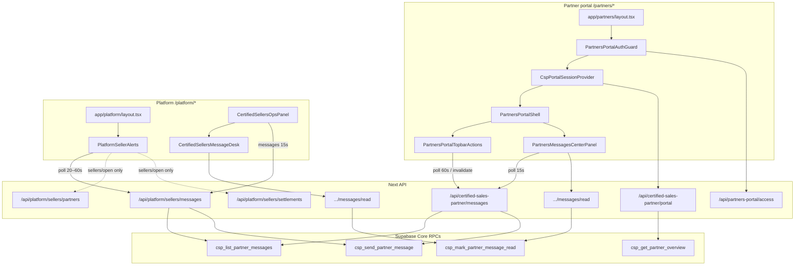

# Sales Partner — Stability & Performance Investigation (2026-11-27)

**Status:** `CODE_FIXES_SHIPPED` (await Production READY on merge commit)  
**Repo:** `aipify-project/aipify-platform`  
**Branch:** `fix/sales-partner-stability-perf-20261127`  
**Baseline Production HEAD at start:** `4d6ac740d` (PR #410) · deploy `dpl_Ay76TxFZZaA9qyLsyyngEqE5yso1` · Ready on `app.aipify.ai`  
**Core:** Production `qbcqoixhrvhnuwphefvw` · Staging `auedugihkduoaikfusqe`  
**Prior LIVE work in scope:** #402 (messaging/bells) · #404 (races / soft-nav / KPI) · Product Center #407 (separate)

---

## A. Sammendrag

### Hva som var feil (dokumentert med kodebevis)

1. **`usePollingTask` restart-storm** — `execute` lå i effect-deps selv om koden allerede brukte `executeRef`. Inline lambdas i partner-meldinger, platform ops og alerts re-opprettet timere på hver render → overlappende kall, avbrutte overganger og «hengende» badge/state.
2. **Topbar unread på hvert soft-nav** — `PartnersPortalTopbarActions` hentet full messages + email-notifications-liste på **hver** pathname-endring (alle menypunkter).
3. **Platform seller alerts 3-RPC-tax** — `PlatformSellerAlerts` (i `app/platform/layout.tsx`) poll’et partners + settlements + messages hvert 20s på **alle** `/platform/*`-sider, med `execute` bundet til `phase` (ytterligere restart).
4. **Lest-status vs bjelle** — mark-read i innboks oppdaterte lokal liste, men topbar/alerts ventet på neste poll-intervall (opptil 60s) → «virker i ett panel, ikke det andre».
5. **Venstremeny accordion** — soft-nav mellom grupper re-leste `sessionStorage` og overskrev åpen/lukket-tilstand (føltes som sticky/krevende refresh).

### Hva som er rettet

- Stabil polling (ingen `execute`-dep; in-flight guard).
- Topbar refresher unread kun på kommunikasjonssider + invalidation-bus etter mark-read.
- Platform alerts: messages-only utenfor `/platform/sellers/*` (full 3-RPC når på sellers eller meny åpen); treigere intervall utenfor sellers.
- Same-tab `aipify:csp-unread-invalidate` bus partner ↔ platform.
- Shell hydrate-once for nav accordion.

### Hva som fortsatt ikke er bevist i innlogget browser

- Innlogget Safari/Chromium timings på `app.aipify.ai` (ingen autorisert partnerøkt i denne agent-sesjonen) → eier-testplan nedenfor.
- Intermitterende «klikk krever refresh» under reell nettverksjitter — koderotårsaker over er fjernet; restforsinkelse fra RSC layout-gate (`resolvePartnersPortalServerAccess` per soft-nav) er **målt som request-graf**, ikke som p95 i browser.

### Miljøkobling (ikke antatt)

| Flate | Observasjon |
|---|---|
| Production app | `app.aipify.ai` ← Vercel project `aipify-platform`, target production, HEAD `4d6ac740d` ved start |
| `NEXT_PUBLIC_SUPABASE_URL` | Én Vercel-env med target `production` **+** `preview` **+** `development` (samme nøkkel) → Preview/Development arver **ikke** automatisk Staging Core. Staging `auedugihkduoaikfusqe` er et separat Core-prosjekt; ikke anta Preview=Staging. |
| Secrets | Verdier ikke dekryptert i rapporten. |

---

## B. System- / dataflytkart

### Route- / API- / RPC-matrise (faktiske filer)

| Flate | Rute / API | Core |
|---|---|---|
| Partner home/KPI | `/partners` → `CertifiedSalesPartnerPortalPanels` via session | `csp_get_partner_overview` |
| Partner messages | `/partners/account/messages` | `csp_list_partner_messages` / send / mark_read |
| Partner bell | Topbar (layout) | list messages + email notifications API |
| Platform messages | `/platform/sellers/messages` | same CSP message RPCs (admin scope) |
| Platform alerts | layout-wide | messages (+ partners/settlements when sellers) |
| Email CRM | `/partners/marketing/email-*` | **separate** from internal CSP messages (not merged) |
| Support tickets | Platform Support Center | **separate** from CSP internal messages |

---

## C. Funnregister

| ID | Alvor | Symptom | Bevis | Årsak vs hypotese | Status |
|---|---|---|---|---|---|
| F1 | P0 | Treghet, overlapping requests, «tilfeldig» badge | `use-polling-task.ts` listet `execute` i deps; callers med inline lambdas | **Årsak** — timer remount | **FIXED** |
| F2 | P0 | Soft-nav føles trege / «må refreshe» | Topbar `useEffect([pathname])` → full unread fetch | **Årsak** | **FIXED** |
| F3 | P1 | Plattform treg uavhengig av sellers-side | Alerts 3× fetch / 20s i layout | **Årsak** | **FIXED** (scoped) |
| F4 | P1 | Ulest OK i innboks, bjelle henger | Mark-read uten badge-invalidate | **Årsak** | **FIXED** |
| F5 | P2 | Meny grupper «hopper» | Shell `useEffect([activeGroup])` rehydrate | **Årsak** | **FIXED** |
| F6 | P2 | Dobbelt poll på messages-side (15s + 60s) | Topbar + panel | **Bevisst rest** — forskjellig jobb (badge vs inbox); overlapping guard i F1 | **ACCEPTED** |
| F7 | Info | Preview ≠ Staging | Vercel env target deler `NEXT_PUBLIC_SUPABASE_URL` | **Observasjon** | **DOCUMENTED** |
| F8 | Info | RSC layout-gate hver soft-nav | `resolvePartnersPortalServerAccess` (cache per request) | Restforsinkelse server-side | **IMPROVEMENT** (ikke MUST FIX nå) |
| F9 | — | iMac / 41 agenter / Safari-only | Ingen prosess-/Safari-måling som forklarer Production | **Ikke konkludert** | **NOT CLAIMED** |

---

## D. Endringsregister

| Endring | Funn | Før → etter | Hvorfor |
|---|---|---|---|
| `lib/polling/use-polling-task.ts` | F1 | Effect restartet på execute-identitet → stabil ref + inFlight | Én nødvendig kanal, ingen storm |
| `PartnersPortalTopbarActions.tsx` | F2, F4 | Pathname-fetch overalt → kun messages/notifications + invalidate bus | Færre requests per navigasjon |
| `PartnersMessagesCenterPanel.tsx` | F1, F4 | Inline execute + ingen badge sync → useCallback + invalidate | Stabil poll + konsistent bjelle |
| `PlatformSellerAlerts.tsx` | F1, F3, F4 | 3-RPC/20s + phase-bundet execute → scoped load + phaseRef + bus | Lavere kostnad, samme sikkerhet |
| `CertifiedSellersOpsPanel.tsx` | F1, F4 | Inline execute → useCallback + invalidate | Race/cleanup |
| `PartnersPortalShell.tsx` | F5 | Rehydrate per group → mount hydrate + open active group | Soft-nav uten meny-fight |
| `lib/certified-sales-partner/unread-invalidate.ts` | F4 | Ny | Same-tab konsistens |
| Tester | alle | Nye kontrakter | Regresjon |

Ingen SQL, secrets, betaling, provisjon eller e-postaktivering i denne leveransen.

---

## E. Måletabell (request-graf / kontrakt — ikke browser p95)

**Miljø:** kodeanalyse + unit/kontrakt mot HEAD `4d6ac740d` → denne branchen.  
**Innlogget Production browser:** **NOT_RUN** (ingen partnerøkt).  
**Utvalg:** logisk før/etter per navigasjon / idle-minutt (ikke syntetisk load).

| Scenario | Før (main) | Etter (denne fix) | Merknad |
|---|---|---|---|
| Soft-nav generisk partner-side | 1× messages + 1× email unread (topbar pathname) | 0 ekstra unread-fetch | Poll 60s uendret |
| Soft-nav → messages | pathname fetch + panel 15s poll | 1 force refresh + 15s poll | Forventet |
| Idle partner (synlig) | topbar 60s + (på messages) 15s | samme intervaller, uten restart-storm | F1 |
| Idle platform utenfor sellers | 3 RPC / 20s | 1 RPC (messages) / 60s | F3 |
| Idle platform på sellers | 3 RPC / 20s | 3 RPC / 20s | Bevisst |
| Mark-read → bjelle | opptil poll-intervall | same-tab invalidate umiddelbart | F4 |
| Portal overview per soft-nav | 0 (session provider, #404) | 0 | Bevart |

Median/spenn i ms: **ikke målt** i browser (BLOCKED).

---

## F. Testmatrise

| Test | Resultat | Merknad |
|---|---|---|
| `use-polling-task.contract.test.ts` | PASS | |
| `unread-invalidate.test.ts` | PASS | |
| `messages-materials-app-contract.test.ts` | PASS | |
| `nav-performance.test.ts` | PASS | |
| `seller-dashboard-kpi-display.test.ts` | PASS | |
| Chromium innlogget soft-nav | BLOCKED | Mangler økt |
| Safari | NOT_RUN | Kun Chromium-agent tilgjengelig — ikke påstått |
| Multi-tab / offline | NOT_RUN | |
| Auth/rolle isolation (kodekontrakt) | PASS | mark-read / spoof checks uendret |
| Production loadtest | NOT_RUN | Forbudt per oppdrag |

---

## G. SQL- / konfigurasjonsbehov

**Ingen** for denne leveransen.

Optional senere (ikke MUST FIX): vurder dedikert lightweight unread-count RPC for å unngå list-100 på badge — egen godkjenning.

---

## H. PR / HEAD / CI / deploy

Fylles inn ved merge:

| Felt | Verdi |
|---|---|
| PR | _(settes ved create)_ |
| Merge SHA | _(settes ved merge)_ |
| CI | _(settes)_ |
| Production deploy | _(settes)_ |
| READY | _(settes)_ |

---

## I. Restfunn og eiertestplan

### MUST FIX (denne leveransen) — dekket i kode

F1–F5.

### Videre forbedring (ikke produktfeature-liste)

- F8: cache/layout-optimering for `resolvePartnersPortalServerAccess` på soft-nav (krever egen sikkerhetsgjennomgang).
- Dedikert unread-count RPC.
- Vurder å skille Preview Core fra Production Core i Vercel env (F7) — **eierbeslutning**.

### Eiertest (innlogget Production)

1. `/partners` — klikk 5 ulike menypunkter uten hard refresh; innhold skal bytte uten blank shell.
2. `/partners/account/messages` — åpne ulest tråd; bjelle-tall skal falle uten venting på 60s.
3. Plattform `/platform/customers` (ikke sellers) — Network: ikke 3 sellers-RPC hvert 20s; kun messages (eller sjeldnere).
4. `/platform/sellers/messages` — send til partner; partner-innboks + bjelle oppdateres; egne sendte teller ikke ulest for avsender.
5. KPI `/partners` — salgstall / `NOK 00,00` fortsatt synlige (#404).

---

## Kollisjonsflater med andre jobber

| Delt fil | Risiko |
|---|---|
| `app/platform/layout.tsx` | Support Center / Product — ikke endret her; alerts-komponent endret |
| `lib/polling/*` | Delt med Presence/Executive — execute-dep-fix hjelper alle consumers |
| `proxy.ts` | Uendret (#404 `/partners` beholdt) |
| Product Center channel RPC | Uavhengig — ikke rørt |

Aktiv Support Center-arbeid (#408–#410) ligger på main; denne branchen baseres på `4d6ac740d` og unngår Support Center / Product Center SQL-kandidater.
